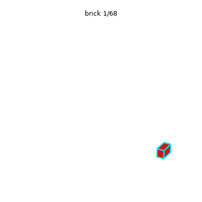
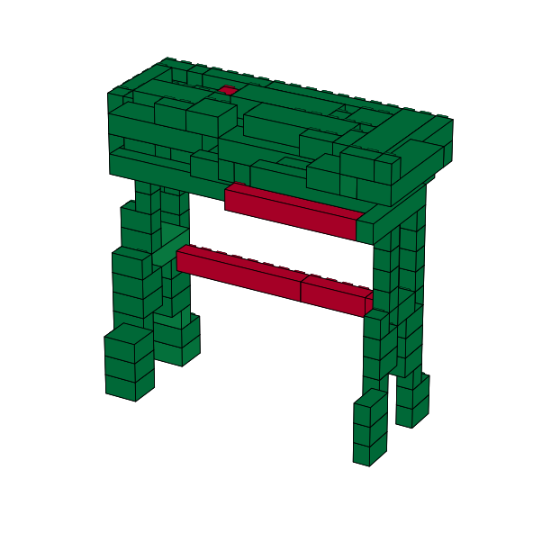

# BrickGPT demo: text → physically stable LEGO structures

Live demo of **BrickGPT** (Pun et al., *Generating Physically Stable and Buildable Brick Structures
from Text*, ICCV 2025 Best Paper, [arXiv:2505.05469](https://arxiv.org/abs/2505.05469)) for the
midterm paper presentation of **Group 8**, *Generative AI for Image Synthesis* (NYCU IIAI30018),
Fall 2026.

You type a description; a fine-tuned Llama-3.2-1B writes the model brick by brick as text, rejects
bricks that collide or leave the grid, and after each full model runs a force-equilibrium check. If
the structure would fall, it rolls back to the last stable brick and continues from there.

| Rollback **on**: 68 bricks, stable | Rollback **off**: 115 bricks, **unstable** (red = fails) |
|---|---|
|  |  |

*"Table featuring a flat rectangular surface over four evenly spaced legs.", seed 42, RTX 5060 Laptop GPU.*

**What this repo adds to the official code:** a one-command install, a web app and terminal demo,
3D renders without Blender, and the physics check running **without a Gurobi licence**: the same
model solved with the open-source HiGHS solver, an exact reformulation and not the repo's
connectivity-only fallback ([docs/gurobi-workaround.md](docs/gurobi-workaround.md)).

---

## 1. Install (once, ~10 min)

**Needs:** Linux, macOS or Windows through **WSL2**; Python 3.10–3.12; ~8 GB free disk.
An NVIDIA GPU with ≥ 6 GB is strongly recommended (on our RTX 5060 Laptop a structure takes 16–70 s).
Without a GPU it runs on the CPU, much more slowly.

1. **Get access to Llama 3.2** (gated model, free): log in at Hugging Face, open
   <https://huggingface.co/meta-llama/Llama-3.2-1B-Instruct> and accept the licence. Wait for the
   approval e-mail.
2. **Create a token:** <https://huggingface.co/settings/tokens> → *Create new token* → type **Read**.
3. **Install:**
   ```bash
   git clone <this repo URL> brickgpt-demo
   cd brickgpt-demo
   ./install.sh            # add --cpu on a machine without an NVIDIA GPU
   ```
   It creates `.venv/`, installs PyTorch and the pinned packages, runs the unit tests, asks for
   your token if you are not logged in yet, and downloads the weights (~2.5 GB).
   If the machine already has a venv with CUDA PyTorch (same Python version), skip the 3 GB
   download with `./install.sh --reuse-torch /path/to/that/venv`.
4. **Check:**
   ```bash
   ./demo.sh check
   ```
   Expected: your GPU, `physics check (HiGHS): stable pair -> True, floating brick -> False`,
   both weights `cached`, `offline mode: on`, and `ALL GOOD`.

No Gurobi licence and no Blender are needed. After the install the demo works **offline**:
`demo.sh` switches Hugging Face to offline mode when the weights are cached.

---

## 2. Run the demo

### Web app (recommended for the presentation)

```bash
./demo.sh app
```
Wait for `Running on local URL: http://127.0.0.1:7860` (about 10 s) and open that address in a
browser. Start it **before** your turn: loading costs ~10 s, and after that each click only costs
the generation time.

| Control | What it does |
|---|---|
| **Describe an object** | the text prompt (pre-filled with the table prompt) |
| **Seed** | same prompt + same seed = same structure; change it for a new design |
| **Physics-informed rollback** | untick to switch off the stability loop (the ablation) |
| **Examples** | one click fills a tested prompt and its seed |
| **3D model** | drag to rotate, scroll to zoom, hover a brick to see its line of model output |
| **Build order** | GIF of the bricks in the order the model wrote them (bottom-up) |
| **Stress score** | each brick coloured by the force analysis: green = safe, red = at its limit or failing |
| **Log** | bricks, seconds, rejected bricks, rollbacks (bricks had → kept), final "physically stable" |
| **Model output** | the raw text the LLM produced: one `hxw (x,y,z)` brick per line |

The terminal running the app prints each rollback as it happens, e.g.
`[physics] structure with 115 bricks is unstable -> roll back to the first 27 stable bricks and regenerate`.

### Demo script (~4 minutes)

| # | Do | Expect (our reference run) | Say |
|---|---|---|---|
| 1 | Click **Generate** with the pre-filled table prompt, seed **42**, rollback **on** | ~70 s · 68 bricks · 1 rollback (115 → 27) · **stable** | "The model writes one brick per line: size and position. Invalid bricks are rejected and resampled. When it finishes, a physics check solves for the forces; here it found a problem, cut back to 27 bricks and let the model continue." |
| 2 | Untick **Physics-informed rollback**, click **Generate** again | ~60 s · 115 bricks · **unstable**; the stress image shows two **red** cross-beams | "Same prompt, same seed, no rollback: it keeps going to 115 bricks. These two beams are only attached sideways, with no studs holding them, so they would fall. That's what the rollback prevented." |
| 3 | (If time) Example **"A small bench…"**, seed **7**, rollback on | ~30 s · 39 bricks · 3 rollbacks · stable | "A smaller object: three rollbacks, still about half a minute." |
| 4 | (If time) A prompt from the audience | | Short, concrete objects work best: the training set is 21 ShapeNet categories. Furniture (chair, table, sofa, bench, bookshelf) and a boat all worked for us. |

Rotate the 3D model after each run. One sentence for the solver, if anyone asks: *"The paper uses
the commercial solver Gurobi for the force analysis; we solve the same model with the open-source
solver HiGHS, so it runs without a licence."* Details for Q&A: [docs/gurobi-workaround.md](docs/gurobi-workaround.md).

Avoid the car prompt live: it needed 11 rollbacks and 275 s.

### Terminal alternatives

```bash
./demo.sh ablation                                  # step 1 + 2 above, in the terminal
./demo.sh cli                                       # type prompts interactively
./demo.sh gen "A small boat with a pointed bow and a flat deck." --seeds 42 1 2
./demo.sh gallery                                   # page with all runs (reference + yours)
```

Every run is saved in `results/runs/<prompt>_s<seed>_<mode>/`: `bricks.txt` (model output),
`bricks.ldr` (opens in LeoCAD / BrickLink Studio), `render.png`, `render_stability.png`,
`build.gif`, `metrics.json`; plus one line in `results/summary.csv`.

### Fallback

If anything fails during the talk, run `./demo.sh gallery`: an offline page with all reference runs
(GIFs, stress renders, numbers). It needs neither the GPU nor the model.

---

## 3. Reference results

All from real runs on an RTX 5060 Laptop GPU (8 GB), seed 42 unless noted; files in
[`reference_runs/`](reference_runs/) (`summary.csv`, one folder per run).

| Prompt | Rollback | Bricks | Time | Rejected bricks | Rollbacks (had → kept) | Physically stable |
|---|---|---|---|---|---|---|
| Table featuring a flat rectangular surface over four evenly spaced legs. | on | 68 | 69 s | 155 | 1 (115 → 27) | **yes** |
| same | off | 115 | 59 s | 155 | – | **no** |
| A classic car with four wheels, a hood and a rounded roof. | on | 121 | 275 s | 464 | 11 | **yes** |
| same | off | 123 | 64 s | 198 | – | **no** (not even connected) |
| A simple chair with a square seat, four legs and a tall straight backrest. | on | 96 | 20 s | 1 | 0 | yes |
| A sofa with a long seat, a backrest and two armrests. | on | 74 | 16 s | 8 | 0 | yes |
| A small boat with a pointed bow and a flat deck. | on | 38 | 20 s | 69 | 0 | yes |
| A tall bookshelf with several horizontal shelves. | on | 56 | 19 s | 42 | 0 | yes |
| A small bench with a flat seat and two legs. (seed 7) | on | 39 | 29 s | 1 | 3 (48→9, 45→9, 42→9) | yes |

- Rollback was needed for 2 of the 6 seed-42 prompts; without it, both come out unstable. For chair,
  sofa, boat and bookshelf the first attempt was already stable, so rollback off gives the same structure.
- "Rejected" is mostly `already_rejected` (the sampler proposing a brick it had already refused),
  then `collision`.
- The table at seed 42 was generated twice and gave a byte-identical `bricks.txt`. On another GPU
  or library version the sampled designs can differ.
- The paper reports a median of 40.8 s per structure on its hardware.

---

## 4. Troubleshooting

| Symptom | Fix |
|---|---|
| `install.sh`: "No access to meta-llama/Llama-3.2-1B-Instruct" | Access not approved yet, or the token belongs to another account. Check the model page, then re-run `./install.sh`. |
| `CUDA out of memory` | Another program holds the GPU (`nvidia-smi`); close it and restart. The model needs ~5.5 GB. |
| `Address already in use` | An old app is still running: `pkill -f app.py`, or `./demo.sh app --port 7861`. |
| "cannot find the requested files in the local cache" | Weights missing: connect to the internet and run `./install.sh` again. |
| A generation takes > 3 min | A long rollback loop. Press Ctrl+C in the terminal, restart the app, try another seed. |
| Browser shows nothing | Use exactly `http://127.0.0.1:7860` (http, not https). |
| Need it on another device | `./demo.sh app --share` prints a temporary public `gradio.live` link (needs internet). |
| `./demo.sh: Permission denied` | `chmod +x demo.sh install.sh`, or run `bash demo.sh ...`. |

Projector on Ubuntu: plug in HDMI, then *Settings → Displays → Mirror*.

---

## 5. How it works / repository layout

```
README.md                 this guide
install.sh                one-time setup (.venv, PyTorch, requirements, tests, weights)
requirements.txt          pinned Python packages (transformers 4.51.3 / peft 0.15.2 as in upstream uv.lock)
demo.sh                   launcher: check | app | ablation | cli | gen | gallery | validate | test-app
app.py                    Gradio web app
run_demo.py               batch / interactive generation; writes results/runs/*
demo_lib.py               generation with logging (rollbacks, checks, timings) + matplotlib/plotly renders
make_gallery.py           builds results/gallery.html from reference_runs/ and results/
brickgpt/                 official BrickGPT code (commit 9c53c7c; only src/brickgpt and tests kept)
  src/brickgpt/stability_analysis/highs_gp.py      NEW: Gurobi-compatible HiGHS backend
  src/brickgpt/stability_analysis/stability_analysis.py   import line changed (BRICKGPT_SOLVER switch)
docs/gurobi-workaround.md why the HiGHS reformulation is exact + validation results
tools/validate_solver.py  HiGHS vs Gurobi (free licence) on 157 structures
tools/debug_disagree.py   prints both solvers' objectives for a given test case
tools/test_app.sh         headless end-to-end test of the web app
reference_runs/           committed outputs of the runs in section 3 + solver validation
```

**Pipeline** (all in the official `brickgpt/src/brickgpt/models/brickgpt.py`):
1. The prompt is wrapped in BrickGPT's instruction template and fed to Llama-3.2-1B-Instruct with the
   BrickGPT LoRA adapter.
2. Each brick is generated token by token with **logit masking**, so the output always has the form
   `hxw (x,y,z)` with a brick size from the library and coordinates inside the 20×20×20 grid.
3. **Rejection sampling:** a brick that collides, is out of bounds or was already rejected is
   resampled (up to 500 times; the temperature rises after repeats).
4. When the model emits end-of-sequence, the **stability analysis** solves for the forces at every
   stud. If any brick fails, all bricks from the first failing one onward are removed and the model
   continues from the stable prefix (**physics-informed rollback**, up to 100 times).

Changes to the official code are limited to the solver backend (`highs_gp.py`, the import in
`stability_analysis.py`, the `use_solver` export in `stability_analysis/__init__.py`). Set
`BRICKGPT_SOLVER=gurobi` to use Gurobi again if you have a full licence.

Renders are matplotlib/plotly boxes with true LEGO proportions (brick height 9.6 mm, stud pitch 8 mm),
instead of the official Blender + LDraw renderer.

## 6. Credits and licence

- Paper and code: Ava Pun, Kangle Deng, Ruixuan Liu, Deva Ramanan, Changliu Liu, Jun-Yan Zhu,
  *Generating Physically Stable and Buildable Brick Structures from Text*, ICCV 2025.
  Code <https://github.com/AvaLovelace1/BrickGPT> (MIT, see `brickgpt/LICENSE`).
- Weights (downloaded, not included): [AvaLovelace/BrickGPT](https://huggingface.co/AvaLovelace/BrickGPT) (MIT) on top of
  [meta-llama/Llama-3.2-1B-Instruct](https://huggingface.co/meta-llama/Llama-3.2-1B-Instruct) (Llama 3.2 Community License).
- Stability model: R. Liu, K. Deng, Z. Wang, C. Liu, *StableLego: Stability Analysis of Block Stacking
  Assembly*, IEEE RA-L 2024. Solver: HiGHS (Huangfu & Hall, 2018) through SciPy.
- Demo code in this repository: MIT, see `LICENSE`.

```bibtex
@inproceedings{pun2025brickgpt,
  title     = {Generating Physically Stable and Buildable Brick Structures from Text},
  author    = {Pun, Ava and Deng, Kangle and Liu, Ruixuan and Ramanan, Deva and Liu, Changliu and Zhu, Jun-Yan},
  booktitle = {ICCV},
  year      = {2025}
}
```
